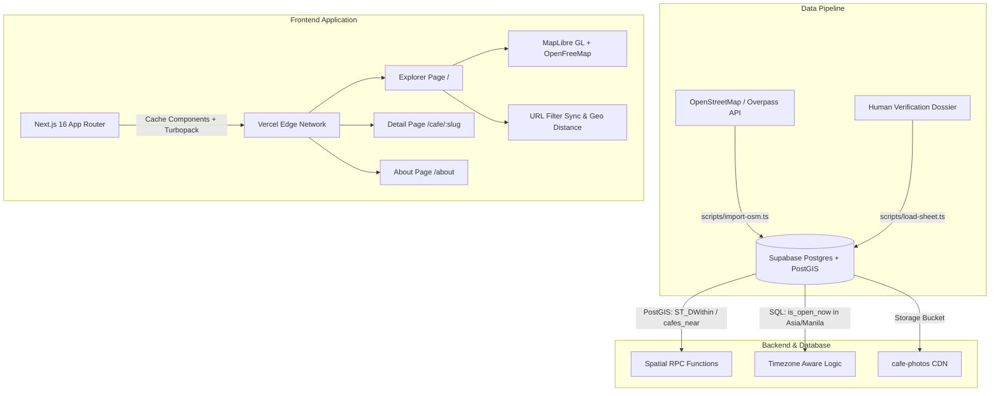

# Brewscout · Cavite Specialty Coffee Finder

> Discover independent, specialty, and homegrown cafés across Cavite, Philippines by the structured criteria Google Maps leaves out: Wi-Fi, outlets, late hours, latte price bands, and architectural vibe.

[](https://nextjs.org/)
[](https://react.dev/)
[](https://tailwindcss.com/)
[](https://maplibre.org/)
[](https://supabase.com/)
[](https://web.dev/progressive-web-apps/)

**Live Production Deployment**: [brewscout-hyuga.vercel.app](https://brewscout-hyuga.vercel.app)

---

## ☕ Why Brewscout?

Cavite is one of the foundational hearts of Philippine coffee—from the historic *Kapeng Barako* (Liberica) and Robusta farms of Amadeo and Silang to the scenic third-wave roasteries overlooking Taal Volcano in Tagaytay.

When remote workers, students, and specialty coffee lovers look for a place to work or unwind, mainstream map apps fail to answer essential questions:
* *Does it actually have reliable Wi-Fi and accessible power outlets?*
* *Is it open past 10 PM or 24/7 for late-night drives?*
* *What is the entry price for a standard espresso latte?*
* *Is the vibe an open-air garden, a scenic ridge view, or a quiet study loft?*

Brewscout addresses this gap with a curated spatial directory of **50 hand-verified independent cafés** across 12 Cavite LGUs, verified with exact PostGIS geographic coordinates, operating windows, and direct photo credits.

---

## 🗺️ Interactive Features

1. **Split Map & List View**:
   - Interactive vector map driven by **MapLibre GL** and free **OpenFreeMap** vector tiles (zero proprietary map billing or tracking).
   - Synchronized markers: clicking any map marker centers and highlights the corresponding café card.
2. **Real-time Filter & Search**:
   - Search by café name, city, or keyword in real time.
   - Filter by City (Tagaytay, Silang, Dasmariñas, Imus, Bacoor, etc.).
   - Filter by Vibe & Amenities: `fast-wifi`, `outlets`, `laptop-friendly`, `open-late`, `with-view`, `aesthetic`, `al-fresco`, `specialty`, `local-beans`, `pet-friendly`.
   - Filter by Max Latte Price (≤ ₱120, ≤ ₱150, ≤ ₱200).
   - "Open now" toggle evaluated against Manila local time (`Asia/Manila`).
   - "Near me" sorting using the browser's Geolocation API with distance formatting.
   - Deep-linked URL state: all active filters sync directly to URL query parameters for sharing.
3. **Café Detail Dossier (`/cafe/[slug]`)**:
   - High-resolution photo carousel with verified owner credits and source links.
   - Day-by-day operating hours with an active "Today" indicator and midnight-crossing support.
   - Google Maps navigation directions link.
   - Social media links (Facebook, Instagram, Website).
   - Native Web Share API integration (with instant clipboard fallback).
4. **Progressive Web App (PWA)**:
   - Web App Manifest (`manifest.webmanifest`) configured with standalone display mode.
   - High-resolution 192x192 and 512x512 app icons, plus Apple Touch Icon.
   - Designed to be installed directly to home screens on iOS and Android.

---

## 📐 Architecture & Tech Stack



### Key Technologies

* **Framework**: [Next.js 16](https://nextjs.org/) (App Router, Partial Prerendering, Cache Components with `"use cache"` and `cacheLife("minutes")`).
* **UI & Styling**: [React 19](https://react.dev/), [Tailwind CSS v4](https://tailwindcss.com/) with a custom warm editorial palette (paper `#faf7f2`, espresso `#6f4325`, ink `#2b2118`, accent `#c8873a`).
* **Typography**: Fraunces (variable display serif) & Geist Sans.
* **Mapping**: [MapLibre GL](https://maplibre.org/) with self-hosted web worker and [OpenFreeMap](https://openfreemap.org/) tiles.
* **Database & Storage**: [Supabase](https://supabase.com/) (PostgreSQL 15, PostGIS extension, Row Level Security, public photo storage bucket).

---

## 🏛️ Cavite Coverage (50 Verified Cafés)

| Municipality / City | Count | Notable Highlights |
|---|:---:|---|
| **Tagaytay** | 10 | Kopakoppi (24/7), 16th Cent Koffie, Bag of Beans, Tsokolateria, Barista Loft, Ruined Project |
| **Silang** | 10 | Café Agapita, Café Dalgona, Gourmet's Café, Haze Coffee House, Kape Amadeo, Forastero Café |
| **Dasmariñas** | 8 | Coffee & Beyond, Forresta Cafe, Alab Grounds, Tinatangi Café, Café Salvacion, Brew 93° |
| **General Trias** | 4 | Kura Cafe, The Alley Cafe, Hiraya Cafe, Harina Cafe |
| **Imus** | 4 | Port Cafe, Chapters Cafe, Typica Coffee, Kape Isla |
| **Bacoor** | 4 | Curated Cafe, Daily Dose, Cafe 10/23, Kape Balita |
| **Kawit** | 2 | Katungkulan Coffee, Aguinaldo Heritage Coffee |
| **Cavite City** | 2 | Ciudad Cafe, San Roque Roasters |
| **Amadeo** | 2 | Café de Amadeo, Pahimis Coffee Hub |
| **Tanza** | 2 | Kape Umaga, Tanza Coast Coffee |
| **Indang** | 1 | Indang Heritage Cafe |
| **Ternate** | 1 | Puerto Azul Lookout Coffee |

---

## 🛠️ Local Development

### 1. Prerequisites
* Node.js 20+
* npm or pnpm

### 2. Environment Setup
Clone the repository and create `.env.local`:
```bash
git clone https://github.com/Hyuga18/Brewscout.git
cd Brewscout
cp .env.example .env.local
```

Fill in your Supabase project credentials in `.env.local`:
```env
SUPABASE_URL=https://<your-project>.supabase.co
SUPABASE_ANON_KEY=<your-anon-key>
# Service role key only needed for maintenance/import scripts:
SUPABASE_SERVICE_ROLE_KEY=<your-service-key>
```

### 3. Install Dependencies & Build MapLibre Worker
```bash
npm install
npm run predev
```

### 4. Run Development Server
```bash
npm run dev
```
Open [http://localhost:3000](http://localhost:3000) to view the app.

### 5. Verification Commands
```bash
npm run typecheck    # Validate TypeScript types
npm run lint         # Run ESLint
npm run build        # Build Next.js production bundle
```

---

## 📜 Data Ingestion & Sync

Brewscout features a two-phase data pipeline:
1. **Raw OSM Ingestion**: `npm run import:osm` queries the Overpass API for all coffee shops in Cavite and imports them as `unverified`.
2. **Boundary Geocoding**: `npm run fill:cities` assigns accurate local government units from OSM boundaries.
3. **Verification Batching**: `npm run load:sheet -- sheet.csv --apply` applies vetted operating hours, prices, tags, and photos to matching slugs and elevates records to `verified`.

---

## 📄 License & Credits

* Built by [Meinard](https://github.com/Hyuga18) as a personal & portfolio project.
* Map tiles by [OpenFreeMap](https://openfreemap.org/) / [OpenStreetMap](https://www.openstreetmap.org/copyright).
* Café photography remains the property of the respective cafés, used under fair attribution with direct links to official social profiles.
